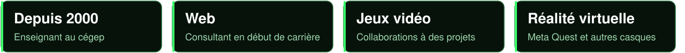
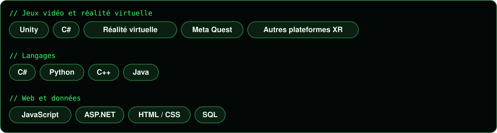
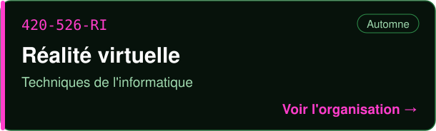
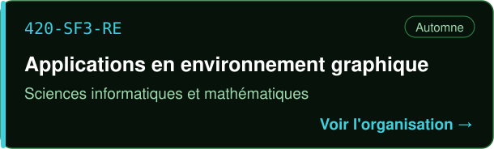
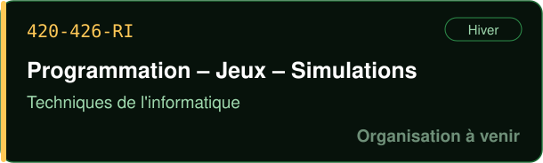
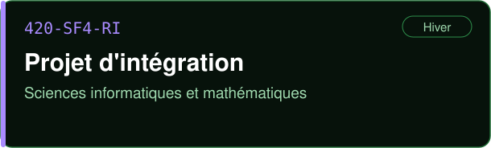
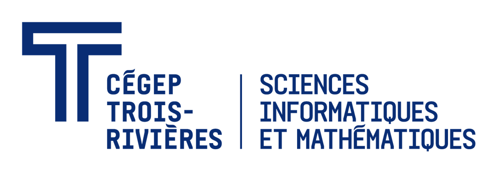

## À propos

Enseignant au **Département d'informatique du Cégep de Trois-Rivières depuis 2000**, je forme les étudiants de **Techniques de l'informatique** et de **Sciences informatiques et mathématiques**. Mes spécialités sont le **développement de jeux vidéo** et la **réalité virtuelle**.

Au début de ma carrière, j'ai été consultant en développement Web. J'ai ensuite collaboré à quelques projets de jeux vidéo. Cette expérience du terrain se retrouve dans mes cours : des projets concrets, des outils actuels et des pratiques professionnelles.

## Expertise

## Activité

## Mes cours

  
  
  
  

Les projets de départ et le matériel de chaque cours se trouvent dans son organisation GitHub.

---

### In English

Computer science teacher at **Cégep de Trois-Rivières** (Québec, Canada) **since 2000**, in the Computer Science Technology and Computer Science & Mathematics programs. Specialized in **video game development** and **virtual reality** with Unity and C#. Former web development consultant, with contributions to several video game projects.

---

  <picture>
    <source media="(prefers-color-scheme: dark)" srcset="assets/logo-info-blanc.png">
    
  </picture>
  &nbsp;&nbsp;&nbsp;&nbsp;
  <picture>
    <source media="(prefers-color-scheme: dark)" srcset="assets/logo-sim-blanc.png">
    
  </picture>

  <a href="https://www.cegeptr.qc.ca">Cégep de Trois-Rivières</a> · Trois-Rivières, Québec

